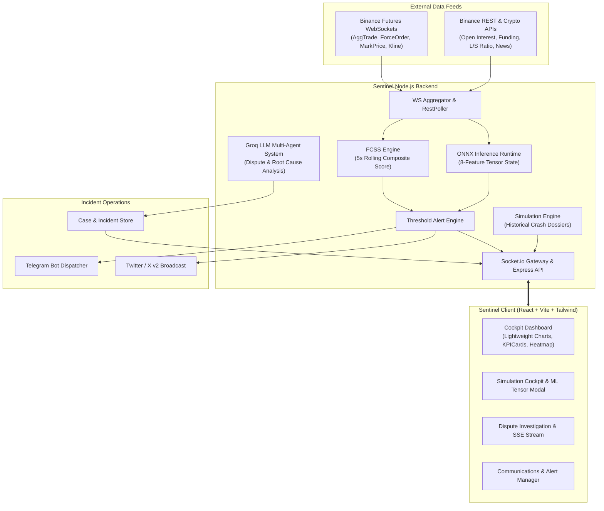

<div align="center">

# 🛡️ SENTINEL
### Autonomous Flash Crash Incident Response & Anomaly Early Warning System

[](https://nodejs.org)
[](https://react.dev)
[](https://vitejs.dev)
[](https://onnxruntime.ai/)
[](https://groq.com)
[](https://socket.io)
[](https://tailwindcss.com)

<p align="center">
  <b>Sentinel</b> is an institutional-grade crypto derivatives surveillance platform and automated incident response system. Engineered for high-volatility regimes, it tracks cascading liquidations, evaluates composite flash-crash susceptibility metrics in real time, runs on-device ONNX neural inference, investigates high-value liquidation disputes via autonomous LLM agents, and orchestrates multi-channel emergency incident response.
</p>

</div>

---

## 📑 Table of Contents

- [Overview](#-overview)
- [Key Features](#-key-features)
- [System Architecture](#-system-architecture)
- [Project Structure](#-project-structure)
- [Getting Started](#-getting-started)
  - [Prerequisites](#prerequisites)
  - [Installation](#installation)
  - [Configuration](#configuration)
  - [Running the Application](#running-the-application)
- [Historical Simulation Engine](#-historical-simulation-engine)
- [Machine Learning & Anomaly Detection](#-machine-learning--anomaly-detection)
- [Multi-Agent Dispute Investigation](#-multi-agent-dispute-investigation)
- [Incident Response & Broadcasts](#-incident-response--broadcasts)
- [Environment Variables](#-environment-variables)
- [Contributing & License](#-contributing--license)

---

## ⚡ Overview

Crypto derivatives markets operate 24/7 with extreme leverage and fragmented cross-exchange liquidity. In cascading liquidation cascades and liquidity vacuum events, price action deteriorates within seconds, leading to catastrophic slippage, exchange outages, and bad debt.

**Sentinel** bridges the gap between raw market telemetry, predictive machine learning, and rapid operational response:
1. **Detects**: Sub-second ingestion of Binance Futures trade, mark price, order book velocity, and forced liquidation feeds.
2. **Predicts**: Computes the **Flash Crash Susceptibility Score (FCSS)** every 5 seconds alongside ONNX-powered ML early-warning neural inference.
3. **Investigates**: Deploys autonomous AI agents (powered by Groq) to analyze market context, order flow anomalies, and auto-triage liquidation disputes over $10,000.
4. **Responds**: Dispatches multi-channel alerts (Telegram Bot, Twitter/X broadcast), logs audit trails with decision quality scoring, and exports audit-ready incident reports.

---

## 🚀 Key Features

### 1. 📡 High-Throughput Live Market Ingestion
- **Binance Futures WebSockets**:
  - `!forceOrder@arr` — Real-time stream of all liquidation events.
  - `!markPrice@arr@1s` — Real-time index and mark price tracking.
  - `btcusdt@aggTrade` — Aggregated trade execution stream for slippage and volume burst detection.
  - `btcusdt@kline_1m` — 1-minute candlestick feeds for continuous OHLCV updates.
- **REST Intelligence Pollers**:
  - Open Interest (OI) & Open Interest change velocity.
  - Top Trader Long/Short ratio.
  - Historical funding rates.
  - Taker buy/sell volume imbalances.
  - Crypto sentiment and news feed integration.

### 2. 🧮 Flash Crash Susceptibility Score (FCSS)
An aggregate composite index scored from **0 to 100** computed every 5 seconds across 8 key dimensions:
- Liquidation velocity & volume surge ($ USD).
- Order book depth decay and bid/ask imbalance.
- Mark-to-index basis divergence.
- Extreme funding rate anomalies.
- Sudden Open Interest contractions (de-leveraging cascades).
- Taker aggressor imbalance.

### 3. 🧠 Embedded ONNX Machine Learning Early Warning
- Pre-trained neural model executed directly in Node.js via `onnxruntime-node` (`sentinel_model.onnx`).
- Evaluates an 8-feature normalized tensor state on every tick.
- Provides probability estimation for sudden crash risk (< 3 min horizon).
- Features an interactive **Feature Tensor Inspector** in the UI with normalized input bars and relative feature attribution.

### 4. 🕹️ Historical Crash Simulation & Replay Engine
Test and validate risk models against 5 historically accurate crash dossiers:
- 📉 **FTX Collapse (Nov 2022)**: Multi-billion dollar balance sheet hole and bank-run liquidity vacuum.
- 💥 **Terra Luna Death Spiral (May 2022)**: Algorithmic stablecoin de-peg triggering relentless hyperinflationary sell-off.
- 🦠 **COVID Black Thursday (Mar 2020)**: 50% single-day crash and BitMEX liquidation cascade.
- 🛑 **China Crypto Mining & Banking Ban (May 2021)**: Nationwide mining shutdown and mass panic selling.
- ⚡ **Leverage Flush (Dec 2021)**: Overnight $2B+ futures flush from over-leveraged long positions.
- **Interactive Controls**: Play, pause, scrub, step-forward, speed modulation (1x, 2x, 5x), and live anomaly tracking.

### 5. 🤖 Multi-Agent Dispute Investigation & Root-Cause Analysis
- Automated case generation whenever a forced liquidation exceeds **$10,000**.
- Built on a multi-agent architectural pipeline (Nyaya architecture) powered by Groq LLM streaming:
  - **Data Collector Agent**: Captures order book snapshot, mark/index deviation, slippage, and spread.
  - **Market Dynamics Agent**: Determines whether the liquidation was orderly or caused by synthetic cascade/flash crash.
  - **Verdict & Dossier Agent**: Produces an executive finding, dispute recommendation (Valid / Questionable / Exchange Fault), and compensation guidance.
- Real-time Server-Sent Events (SSE) streaming directly into the analyst investigation UI.

### 6. 🚨 Multi-Channel Incident Response & Operations
- **Telegram Bot**: Instant dispatch of critical alarms (FCSS > 70, liquidation waves, ML anomalies).
- **Twitter / X API v2**: Automated public status and incident broadcast capability.
- **Auditable Event Timeline**: Chronological log of system alerts, operator interventions, and decision quality scoring.
- **Playbook Engine & Dossier Export**: Download complete incident post-mortems and audit-ready dossiers in Markdown / PDF format.

---

## 🏛️ System Architecture



---

## 📁 Project Structure

```text
sentinel/
├── client/                     # Frontend Application (React + Vite + Tailwind CSS)
│   ├── public/                 # Static assets and icons
│   ├── src/
│   │   ├── components/         # Reusable UI, Dashboard, Simulation, Layout components
│   │   ├── hooks/              # Custom hooks (useSocket, useAlerts, etc.)
│   │   ├── pages/              # Dashboard, Simulation, Disputes, Alerts, Comms, Timeline
│   │   ├── store/              # Zustand global state stores
│   │   ├── App.jsx             # Route definitions and layout shell
│   │   └── main.jsx            # Entry point
│   ├── index.html
│   ├── package.json
│   ├── tailwind.config.js
│   └── vite.config.js
├── server/                     # Backend Application (Node.js + Express + Socket.io)
│   ├── agents/                 # Multi-agent investigation & LLM prompt orchestration
│   │   ├── crashAnalyser.js    # Simulation & crash telemetry analyzer
│   │   └── investigator.js     # Dispute triage & verdict generator
│   ├── alerts/                 # Threshold & alerting logic
│   ├── cases/                  # Case store & liquidation ticket management
│   ├── data/                   # Historical crash dossiers & incident store
│   │   ├── incidentStore.js    # Persistent incident event tracker
│   │   └── scenarios.json      # 5 historical crash simulation profiles
│   ├── lib/                    # Shared clients (Groq SDK client, etc.)
│   ├── ml/                     # Machine learning inference
│   │   ├── inference.js        # 8-feature tensor constructor & ONNX evaluation
│   │   └── sentinel_model.onnx # Trained neural early-warning classifier
│   ├── routes/                 # REST endpoints (market, cases, simulation, ml, analysis)
│   ├── signals/                # Auxiliary signals (sentiment, support tickets)
│   ├── simulation/             # Frame generator & historical replay engine
│   ├── ws/                     # Binance WebSocket connections, aggregator, REST pollers
│   └── index.js                # Core server bootstrap & pipeline coordinator
├── colab_training_script.py    # Python script for training Sentinel neural model
├── download_dataset.py         # Utility to fetch 1m historical kline datasets
├── nodemon.json                # Server development watcher configuration
├── package.json                # Root package scripts (concurrent client + server)
└── README.md                   # Project documentation
```

---

## 🛠️ Getting Started

### Prerequisites

- **Node.js**: v18.0.0 or higher
- **npm**: v9.0.0 or higher
- *(Optional)* **Groq API Key**: For autonomous LLM dispute investigation & AI incident drafting ([Get a free key](https://console.groq.com/keys))
- *(Optional)* **Telegram Bot Token & Chat ID**: For operational alert notifications
- *(Optional)* **Twitter / X API v2 Credentials**: For automated broadcast posts

### Installation

1. **Clone the repository**:
   ```bash
   git clone https://github.com/Anupk17/Sentinel.git
   cd Sentinel
   ```

2. **Install root dependencies**:
   ```bash
   npm install
   ```

3. **Install client and server dependencies**:
   ```bash
   # Install server dependencies
   cd server && npm install
   
   # Install client dependencies
   cd ../client && npm install
   
   # Return to root
   cd ..
   ```

### Configuration

Copy the example environment file and configure your credentials:

```bash
cp .env.example .env
```

Edit `.env` (or `server/.env`) with your preferred settings:

```ini
# Server Configuration
PORT=3001
CLIENT_ORIGIN=http://localhost:5173

# LLM Intelligence (Groq API for multi-agent root-cause analysis & dispute resolution)
GROQ_API_KEY=gsk_your_groq_api_key_here

# Incident Notifications - Telegram Bot (Optional)
TELEGRAM_BOT_TOKEN=your_telegram_bot_token_here
TELEGRAM_CHAT_ID=your_telegram_chat_id_here

# Social Broadcasts - Twitter / X API v2 (Optional)
TWITTER_API_KEY=your_twitter_api_key
TWITTER_API_SECRET=your_twitter_api_secret
TWITTER_ACCESS_TOKEN=your_twitter_access_token
TWITTER_ACCESS_SECRET=your_twitter_access_secret
```

> **Note**: Sentinel runs smoothly even without optional Telegram or Twitter keys. Market ingestion, FCSS calculation, ONNX inference, and simulation replay will function fully out of the box.

### Running the Application

Sentinel provides concurrent root scripts to run both server and client together:

```bash
# Run both Server (port 3001) and Client (port 5173) concurrently
npm run dev

# Or run components individually:
npm run dev:server    # Starts backend with nodemon
npm run dev:client    # Starts client with Vite
```

Once started:
- **Client UI**: Open [http://localhost:5173](http://localhost:5173)
- **API Server & Socket Gateway**: Available at [http://localhost:3001](http://localhost:3001)

---

## 🕹️ Historical Simulation Engine

Navigate to the **Simulation** tab in the client to inspect historical crash events.

| Scenario ID | Historical Event | Timestamp | Peak Cascade |
| :--- | :--- | :--- | :--- |
| `ftx_collapse_2022` | **FTX Liquidity Crisis** | Nov 08, 2022 | $1.2B+ liquidations, -24% drop |
| `luna_death_spiral_2022` | **Terra/Luna De-peg** | May 09, 2022 | Hyperinflationary cascade, -56% drop |
| `covid_black_thursday_2020` | **COVID Flash Crash** | Mar 12, 2020 | BitMEX index gap, -48% in 24h |
| `china_ban_2021` | **China Mining Ban** | May 19, 2021 | Network hashrate halving, -31% drop |
| `leverage_flush_2021` | **Overnight Long Squeeze** | Dec 04, 2021 | $2.5B futures flush in 4 hours |

### Controls & Inspection
- **Play / Pause / Step**: Control replay cadence with sub-second accuracy.
- **Speed Multipliers**: Replay at 1x, 2x, or 5x speed.
- **FCSS Anomaly Series**: Synchronized secondary chart series mapping price action to anomaly probability.
- **ML Tensor Evaluator**: Inspect the live 8-dimensional normalized input vector and observe how features cross decision boundaries in real time.
- **AI Crash Dossier**: Trigger Groq LLM post-mortem analysis directly on the recorded frame buffer.

---

## 🧠 Machine Learning & Anomaly Detection

Sentinel's early warning model processes an 8-dimensional feature tensor:

1. **Normalized Volatility**: 1-minute high-low range normalized against rolling ATR.
2. **Liquidation Intensity**: Rolling 1-minute forced liquidation volume ($ USD).
3. **Liquidation Count**: Frequency of margin call events per time window.
4. **Volume Anomaly Index**: Ratio of current taker volume to 30-period rolling average.
5. **Mark/Index Basis Spread**: Basis spread tracking pricing discrepancies and exchange slippage.
6. **Open Interest Velocity**: Rate of change in active open contracts ($dOI / dt$).
7. **Funding Velocity**: Sharpness of funding rate spikes or drops.
8. **Taker Imbalance Ratio**: Aggressor buy volume versus aggressor sell volume.

The ONNX classifier outputs a real-time crash probability. When the probability breaches threshold limits (> 0.70), the system enters **Focus Mode**, elevating telemetry sampling and alerting operators immediately.

---

## 🤖 Multi-Agent Dispute Investigation

When a trader's position is liquidated during turbulent market conditions, dispute resolution often takes days or weeks. Sentinel automates this through its **Dispute Resolution Engine**:

1. **Auto-Ticket Creation**: Any liquidation order exceeding $10,000 automatically spins up an investigation dossier.
2. **Market State Reconstruction**: Exact order book depth, basis divergence, slippage, and spread at the millisecond of liquidation are locked.
3. **Agent Consensus**:
   - Evaluates if the liquidation was executed within normal market parameters.
   - Flags predatory wick hunts, exchange latency spikes, or order book vacuums.
   - Recommends an auditable verdict: **Affirmed**, **Partial Refund**, or **Full Restitution**.
4. **Human-in-the-Loop**: Incident commanders can review the streamed agent reasoning via SSE, approve recommendations, or record manual overrides.

---

## 📢 Incident Response & Broadcasts

- **Automated Telegram Alarms**: Formatted alerts detailing the crash severity, liquidation volume, and active market conditions sent directly to security operations channels.
- **Twitter / X Incident Post Composer**: AI-assisted incident updates drafted via Groq to provide transparent, accurate status updates to traders and community stakeholders.
- **Audit Reports**: Instant one-click PDF and Markdown export of incident timelines, operator actions, and quantitative market metrics for regulatory and compliance review.

---

## ⚙️ Environment Variables

| Variable | Required | Default | Description |
| :--- | :---: | :---: | :--- |
| `PORT` | Optional | `3001` | Port on which the Express server and Socket.io gateway listen. |
| `CLIENT_ORIGIN` | Optional | `http://localhost:5173` | Allowed CORS origin for frontend client requests. |
| `GROQ_API_KEY` | Optional | — | Groq API key for multi-agent dispute analysis and AI incident drafting. |
| `TELEGRAM_BOT_TOKEN` | Optional | — | Telegram Bot API token for dispatching high-priority alerts. |
| `TELEGRAM_CHAT_ID` | Optional | — | Target Telegram channel or group chat ID for alerts. |
| `TWITTER_API_KEY` | Optional | — | Twitter / X developer app API key. |
| `TWITTER_API_SECRET` | Optional | — | Twitter / X developer app API secret. |
| `TWITTER_ACCESS_TOKEN` | Optional | — | Twitter / X user access token. |
| `TWITTER_ACCESS_SECRET`| Optional | — | Twitter / X user access secret. |

---

## 📄 License

This project is licensed under the [MIT License](LICENSE).

---

<div align="center">
  <sub>Built with ❤️ for high-reliability financial markets & algorithmic resilience.</sub>
</div>
